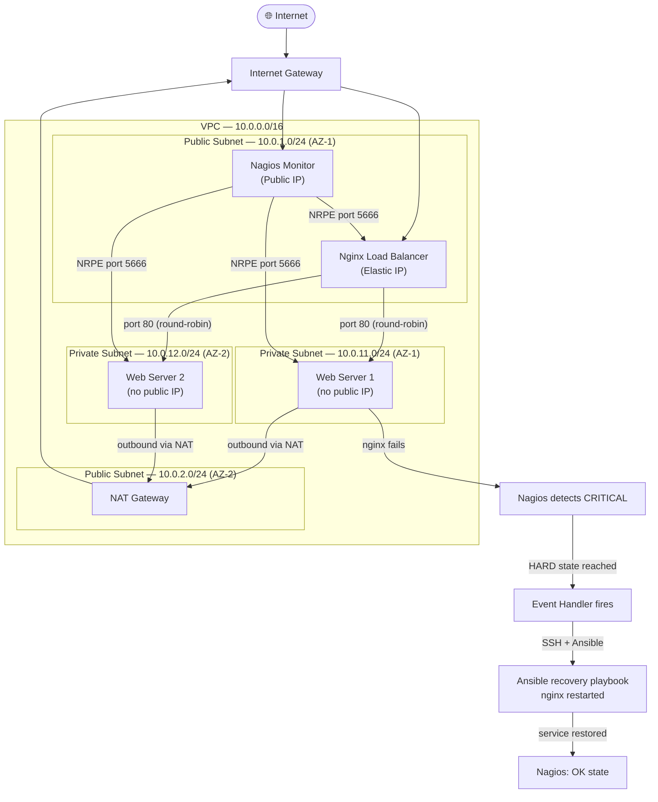

# Architecture: Automated Self-Healing Web Infrastructure

## Executive Summary

This project implements a production-grade, automated self-healing web infrastructure on AWS using Infrastructure-as-Code (Terraform) and Configuration Management (Ansible). The system hosts a load-balanced web application across two private-subnet EC2 instances fronted by an Nginx reverse proxy/load balancer in the public subnet, with comprehensive health monitoring provided by Nagios Core and its NRPE agents. The entire stack is provisioned reproducibly from code, eliminating manual setup and enabling rapid disaster recovery.

The defining capability of this architecture is autonomous self-healing: when Nagios detects that the Nginx service on a web node has entered a HARD failure state, it automatically triggers an event handler that invokes an Ansible recovery playbook over SSH, restarting the failed service without human intervention. Combined with Nginx's built-in upstream health checking (which automatically removes unhealthy backends from the pool), the system maintains continuous availability even during node-level service failures — achieving the fault-tolerance goals required by modern DevOps practices.

---

## System Components

| Component | Instance Type | Subnet | Public IP | Security Group | Role |
|---|---|---|---|---|---|
| Nginx Load Balancer | t3.micro | public (10.0.1.0/24) | Yes (Elastic IP) | lb_sg | Routes and load-balances traffic to web servers |
| Web Server 1 | t3.micro | private (10.0.11.0/24) | No | web_sg | Serves application content |
| Web Server 2 | t3.micro | private (10.0.12.0/24) | No | web_sg | Serves application content (redundancy) |
| Nagios Monitor | t3.micro | public (10.0.1.0/24) | Yes | nagios_sg | Health monitoring, alerting & self-healing automation |

---

## Network Architecture

---

## VPC Network Design

| Subnet Name | CIDR Block | Availability Zone | Type | Purpose |
|---|---|---|---|---|
| public-subnet-1 | 10.0.1.0/24 | us-east-1a | Public | Nginx LB, Nagios Server |
| public-subnet-2 | 10.0.2.0/24 | us-east-1b | Public | NAT Gateway (HA placement) |
| private-subnet-1 | 10.0.11.0/24 | us-east-1a | Private | Web Server 1 |
| private-subnet-2 | 10.0.12.0/24 | us-east-1b | Private | Web Server 2 |

> [!NOTE]
> Private subnets have no route to the Internet Gateway. Outbound internet access for private instances (e.g., for `apt install`) is provided exclusively through the NAT Gateway, which performs source-address translation.

---

## Security Group Rules

### `lb_sg` — Load Balancer Security Group

| Direction | Protocol | Port | Source/Destination | Description |
|---|---|---|---|---|
| Inbound | TCP | 80 | 0.0.0.0/0 | HTTP from internet |
| Inbound | TCP | 443 | 0.0.0.0/0 | HTTPS from internet |
| Inbound | TCP | 22 | var.allowed_ssh_cidr | SSH from admin |
| Outbound | All | All | 0.0.0.0/0 | All outbound |

### `web_sg` — Web Server Security Group

| Direction | Protocol | Port | Source/Destination | Description |
|---|---|---|---|---|
| Inbound | TCP | 80 | lb_sg (SG reference) | HTTP from LB only |
| Inbound | TCP | 5666 | nagios_sg (SG reference) | NRPE from Nagios only |
| Inbound | TCP | 22 | nagios_sg (SG reference) | SSH from Nagios (for Ansible recovery) |
| Outbound | All | All | 0.0.0.0/0 | All outbound (via NAT) |

### `nagios_sg` — Nagios Security Group

| Direction | Protocol | Port | Source/Destination | Description |
|---|---|---|---|---|
| Inbound | TCP | 80 | var.allowed_nagios_ui_cidr | Nagios web UI access |
| Inbound | TCP | 22 | var.allowed_ssh_cidr | SSH from admin |
| Outbound | All | All | 0.0.0.0/0 | All outbound |

> [!IMPORTANT]
> The `web_sg` rules use **Security Group references** (not CIDR blocks) for ports 80 and 5666. This is the AWS best practice: only the load balancer's security group and Nagios's security group can reach the web nodes — no other source IP, however crafted, can bypass this control.

---

## Self-Healing Mechanism (Step-by-Step)

1. **Failure occurs** — The `nginx` service on Web Server 1 (or Web Server 2) crashes or is stopped.
2. **Nagios detects degradation** — The NRPE service check `check_nginx` polls every 60 seconds (configurable). On the next poll, it returns `CRITICAL` (HTTP connection refused on port 80).
3. **SOFT state** — Nagios re-checks the service `max_check_attempts` times (default: 3) over the check interval before escalating. This prevents flapping alerts on transient blips.
4. **HARD state reached** — After 3 consecutive failures, Nagios transitions the service to a **HARD CRITICAL** state.
5. **Event handler fires** — Nagios executes the configured `event_handler` command. The bash script `/usr/local/nagios/libexec/event_handlers/restart_nginx.sh` is called with state type `HARD` and state `CRITICAL`.
6. **Ansible recovery playbook runs** — The event handler script SSHes from the Nagios server to the affected web node (using the deployment key) and runs `ansible-playbook recover_nginx.yml`, which executes `sudo systemctl start nginx` idempotently.
7. **Nginx service restored** — The web node's nginx process is running again and accepting connections on port 80.
8. **Nagios detects recovery** — On the next check cycle, Nagios receives an HTTP 200 from the NRPE check. The service transitions to `OK`.
9. **Notification sent** — Nagios sends a recovery email/notification to the contacts group.
10. **LB resumes routing** — Nginx LB's `fail_timeout=30s` window expires and the backend is re-added to the upstream pool automatically.

---

## Nagios Service Checks

| Check Name | Host Target | Check Command | Warning Threshold | Critical Threshold | Notes |
|---|---|---|---|---|---|
| HTTP LB | nginx_lb | check_http | N/A | Non-200 response | Verifies LB is reachable |
| HTTP Web1 | web1 | check_nrpe!check_http | N/A | Non-200 response | Via NRPE agent |
| HTTP Web2 | web2 | check_nrpe!check_http | N/A | Non-200 response | Via NRPE agent |
| Nginx Process LB | nginx_lb | check_nrpe!check_nginx_proc | N/A | 0 processes | NRPE local check |
| Nginx Process Web1 | web1 | check_nrpe!check_nginx_proc | N/A | 0 processes | Triggers event handler |
| Nginx Process Web2 | web2 | check_nrpe!check_nginx_proc | N/A | 0 processes | Triggers event handler |
| CPU Load | all hosts | check_nrpe!check_load | 5,4,3 | 10,8,6 | 1/5/15-min averages |
| Disk / | all hosts | check_nrpe!check_disk | 20% free | 10% free | Root partition |
| Ping | all hosts | check_ping | 200ms 20% | 500ms 60% | ICMP reachability |

---

## Traffic Flow

### Inbound Request (User → Application)

1. User's browser sends an HTTP GET to the **Elastic IP** of the Nginx Load Balancer.
2. The request traverses the **Internet Gateway** and reaches the LB instance in the public subnet.
3. Nginx (configured with `upstream web_pool`) selects a backend using the **round-robin** algorithm (or `least_conn` if configured).
4. Nginx issues a `proxy_pass` to the selected web server's **private IP** on port 80. Because the LB is in the same VPC, this is a direct private routing — no NAT required.
5. The web server processes the request and returns the response to Nginx.
6. Nginx forwards the response back to the client.

### Outbound (Private Instances → Internet)

Private instances (web nodes) have no route to the Internet Gateway. When they need to reach the internet (e.g., `apt update`), their traffic is routed to the **NAT Gateway** in the public subnet, which translates the source IP to its own Elastic IP before forwarding to the Internet Gateway. Return traffic is translated back by NAT and delivered to the private instance.

### Monitoring Path

Nagios Server → NRPE plugin (TCP 5666) → NRPE agent on each host → executes local check command → returns status code and performance data to Nagios.
