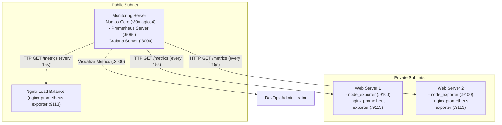

# Optional Add-on Guide: Prometheus & Grafana Monitoring

This document details how to extend the infrastructure with an optional modern observability stack featuring **Prometheus** (metrics scraping and time-series database) and **Grafana** (interactive metric visualization dashboards).

---

## 1. Architectural Role: Nagios vs. Prometheus & Grafana

| Capability | Nagios Core | Prometheus & Grafana |
|---|---|---|
| **Primary Focus** | Active health polling, threshold alerting, automated recovery (event handlers) | Time-series metrics collection, numerical telemetry, trend analysis, dashboards |
| **Data Model** | Discrete states (`OK`, `WARNING`, `CRITICAL`, `UNKNOWN`) | Multi-dimensional time-series data with key-value labels |
| **Pull vs Push** | Active execution of check commands (plugins / NRPE) | Pull model over HTTP (`/metrics`) using exporters |
| **Visualizations** | Basic static status maps and CGI tables | Rich interactive dynamic dashboards with alerting integrations |
| **Self-Healing Integration** | Native event handlers executing local bash/Ansible scripts | Alertmanager can trigger webhooks, but requires intermediary glue |

> **Best-Practice Synergy:** In enterprise environments, Nagios excels at transactional state verification and instant remediation triggers, while Prometheus and Grafana provide deep operational visibility and capacity planning insights.

---

## 2. Target Observability Architecture



---

## 3. Implementation Steps

### Step 1: Install Node Exporter on Managed Nodes
Deploy `node_exporter` (version `1.8.x`) on the Load Balancer and backend web servers to expose OS-level metrics (CPU, RAM, Disk, Network) on port `9100`.

An Ansible task snippet:
```yaml
- name: Download Node Exporter
  ansible.builtin.get_url:
    url: "https://github.com/prometheus/node_exporter/releases/download/v1.8.2/node_exporter-1.8.2.linux-amd64.tar.gz"
    dest: "/tmp/node_exporter.tar.gz"
    mode: "0644"

- name: Extract and install Node Exporter binary
  ansible.builtin.unarchive:
    src: "/tmp/node_exporter.tar.gz"
    dest: "/usr/local/bin/"
    remote_src: true
    extra_opts: ["--strip-components=1", "--wildcards", "*/node_exporter"]

- name: Create systemd service for node_exporter
  ansible.builtin.copy:
    dest: /etc/systemd/system/node_exporter.service
    content: |
      [Unit]
      Description=Prometheus Node Exporter
      After=network.target

      [Service]
      User=nobody
      ExecStart=/usr/local/bin/node_exporter

      [Install]
      WantedBy=multi-user.target

- name: Start node_exporter
  ansible.builtin.systemd:
    name: node_exporter
    state: started
    enabled: true
```

### Step 2: Install Prometheus on the Monitoring EC2 Instance
On the Nagios/Monitoring EC2 instance, install Prometheus and configure `/etc/prometheus/prometheus.yml`:

```yaml
global:
  scrape_interval: 15s
  evaluation_interval: 15s

scrape_configs:
  - job_name: 'prometheus'
    static_configs:
      - targets: ['localhost:9090']

  - job_name: 'node_exporters'
    static_configs:
      - targets:
          - '10.0.11.10:9100'  # Web Server 1 Private IP
          - '10.0.12.20:9100'  # Web Server 2 Private IP
          - '10.0.1.5:9100'   # Nginx LB Private IP

  - job_name: 'nginx_load_balancer'
    static_configs:
      - targets: ['10.0.1.5:9113']
```

### Step 3: Install and Launch Grafana
Install Grafana on the monitoring instance:
```bash
sudo apt-get install -y apt-transport-https software-properties-common wget
sudo mkdir -p /etc/apt/keyrings/
wget -q -O - https://apt.grafana.com/gpg.key | gpg --dearmor | sudo tee /etc/apt/keyrings/grafana.gpg > /dev/null
echo "deb [signed-by=/etc/apt/keyrings/grafana.gpg] https://apt.grafana.com stable main" | sudo tee -a /etc/apt/sources.list.d/grafana.list
sudo apt-get update
sudo apt-get install -y grafana
sudo systemctl enable --now grafana-server
```

Access Grafana at `http://<NAGIOS_PUBLIC_IP>:3000` (Default credentials: `admin` / `admin`).

---

## 4. Key Metrics and PromQL Queries

1. **CPU Utilization Percentage:**
   ```promql
   100 - (avg by (instance) (rate(node_cpu_seconds_total{mode="idle"}[2m])) * 100)
   ```

2. **Available Memory Percentage:**
   ```promql
   (node_memory_MemAvailable_bytes / node_memory_MemTotal_bytes) * 100
   ```

3. **Disk Space Usage Percentage:**
   ```promql
   100 - ((node_filesystem_avail_bytes{mountpoint="/"} * 100) / node_filesystem_size_bytes{mountpoint="/"})
   ```

4. **Nginx Active Connections:**
   ```promql
   nginx_connections_active
   ```

5. **HTTP Request Rate (per second):**
   ```promql
   sum(rate(nginx_http_requests_total[1m])) by (instance)
   ```

---

## 5. Summary Recommendation for College Viva
When asked: *"Why did you use Nagios instead of Prometheus/Grafana?"*
> *"We implemented Nagios Core because our primary architectural requirement was an active, closed-loop **Self-Healing Mechanism**. Nagios provides native event handlers that trigger Ansible playbooks directly when a service changes from SOFT to HARD critical states. However, we also designed an architectural blueprint for Prometheus and Grafana as an optional observability layer to capture granular time-series metrics and real-time dashboard analytics."*
